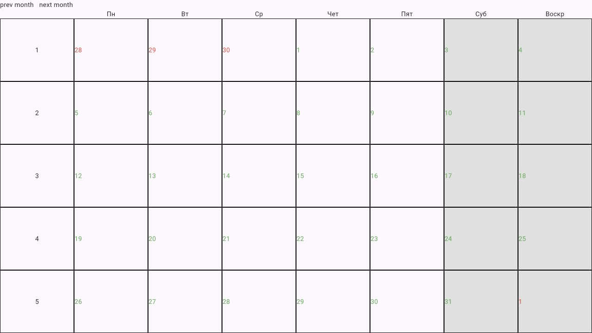
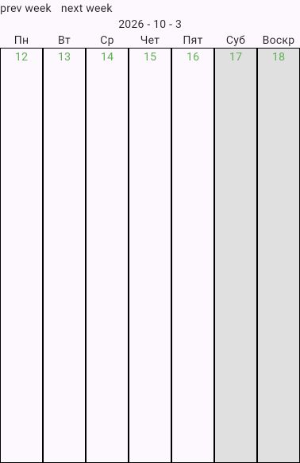

# calendar_ui

Настраиваемые Flutter-виджеты календаря для LKO Planner: сетка месяца и строка
недели, общий контроллер навигации и выбор дня. Расчёты дат выполняет пакет
[calendar](https://github.com/Hecatoncheir/calendar).
Оформление ячеек и заголовков задаётся через builders.

## Скриншоты

### Месяц



### Неделя



Скриншоты сделаны из работающих web-примеров в `example/lib`.
В примерах выходные выделены серым, дни показанного месяца — зелёным,
соседних месяцев — красным. Начальная дата определяется через `DateTime.now()`.
Оформление принадлежит примерам и настраивается в приложении.

## Возможности

- `CalendarMonthUI` — полный месяц с днями соседних месяцев по краям.
- `CalendarWeekUI` — показанная неделя.
- `CalendarController` — переходы между месяцами и неделями, выбор дня.
- `CalendarSelection` — состояние: год, месяц, номер недели и выбранный день.
- Builders для дней, ячеек и заголовков; у месячного виджета также для названия
  месяца и номеров недель.
- `allWeekDays` и `workWeekDays` — вся неделя или только рабочие дни.
- `weekNumberWidth` — ширина колонки номеров недель в месячном виде.

Неделя начинается с понедельника. Её номер считается внутри сетки месяца,
а не по ISO 8601. Недельная навигация между месяцами идёт по датам.
Листание сохраняет выбранный день; `selectDay` переходит к месяцу и неделе
новой даты. Нажатия на дни задайте в собственном builder через `selectDay`.

## Требования и подключение

Flutter `>=3.44.0`, Dart `>=3.12.0 <4.0.0` и Git.
Пакет имеет `publish_to: none`; добавьте в `pubspec.yaml` приложения:

```yaml
dependencies:
  flutter:
    sdk: flutter
  calendar_ui:
    git:
      url: https://github.com/Hecatoncheir/calendar_ui.git
```

Для воспроизводимых сборок добавьте `ref` с нужным commit или tag.
Зависимость `calendar` уже подключена самим пакетом на фиксированный commit.
Выполните `flutter pub get`.

Для локальной разработки используйте `calendar_ui: {path: ../calendar_ui}`.
Если одновременно меняете `calendar`, задайте в корневом `pubspec.yaml`
приложения временный `dependency_overrides` с `calendar: {path: ../calendar}`.

## Минимальный пример

```dart
import 'package:calendar_ui/calendar_ui.dart';
import 'package:flutter/material.dart';

void main() => runApp(const MaterialApp(home: CalendarPage()));

class CalendarPage extends StatefulWidget {
  const CalendarPage({super.key});

  @override
  State<CalendarPage> createState() => _CalendarPageState();
}

class _CalendarPageState extends State<CalendarPage> {
  final controller = CalendarController(DateTime.now());

  @override
  void dispose() {
    controller.dispose();
    super.dispose();
  }

  @override
  Widget build(BuildContext context) => Scaffold(
    appBar: AppBar(title: const Text('Календарь')),
    body: Column(
      children: [
        Row(
          children: [
            IconButton(
              onPressed: controller.prevMonth,
              tooltip: 'Предыдущий месяц',
              icon: const Icon(Icons.chevron_left),
            ),
            IconButton(
              onPressed: controller.nextMonth,
              tooltip: 'Следующий месяц',
              icon: const Icon(Icons.chevron_right),
            ),
          ],
        ),
        Expanded(
          child: CalendarMonthUI(
            controller: controller,
            isMonthNameMustBeCreated: true,
            dayBuilder: (month, day, selectedDay) => InkWell(
              onTap: () => controller.selectDay(day.date),
              child: Center(
                child: Text(
                  '${day.day}',
                  style: TextStyle(
                    fontWeight: day.isSameDayAs(selectedDay)
                        ? FontWeight.bold
                        : FontWeight.normal,
                  ),
                ),
              ),
            ),
          ),
        ),
      ],
    ),
  );
}
```

Виджету нужна ограниченная высота: внутри `Column` используйте `Expanded`,
либо задайте размер через `SizedBox`.
Состояние доступно сразу через `controller.value`; для подписки используйте
`ValueListenableBuilder` или `addListener`. Освобождайте контроллер через `dispose`.
Для недельного вида используйте `CalendarWeekUI` и методы `prevWeek` / `nextWeek`.

## Запуск примеров

```bash
git clone https://github.com/Hecatoncheir/calendar_ui.git
cd calendar_ui
flutter pub get
cd example
flutter pub get
flutter run -d chrome -t lib/calendar_month_ui.dart
```

Недельный пример запускается отдельно:

```bash
flutter run -d chrome -t lib/calendar_week_ui.dart
```

Для другого устройства замените `chrome` на его ID из `flutter devices`.
Стандартного `lib/main.dart` в примере нет: обязательно указывайте `-t`.

## Проверка и зависимости

Из корня репозитория:

```bash
flutter test
flutter analyze
flutter pub outdated
```

Тесты проверяют навигацию контроллера, смену месяца и недели, полноту сетки,
набор показанных дней и ширину колонки недель.
Обновляйте зависимости корня и примера отдельно:

```bash
flutter pub upgrade
cd example
flutter pub upgrade
flutter analyze
flutter build web -t lib/calendar_month_ui.dart
flutter build web -t lib/calendar_week_ui.dart
```

Часть транзитивных зависимостей закреплена Flutter SDK; обновление таких пакетов
зависит от версии Flutter.

## CI и релизы

[История изменений](CHANGELOG.md). GitHub Actions запускается при push в основную
ветку, pull request и вручную через **Actions → CI и релиз → Run workflow**.
После проверок он сохраняет артефакт `release-vX.Y.Z` на 14 дней: исходники,
описание изменений и `SHA256SUMS`. Для `calendar_ui` также
прилагаются архивы web-примеров месяца и недели.

Для следующего релиза:

1. Обновите `version` в `pubspec.yaml` и добавьте раздел `## X.Y.Z - YYYY-MM-DD`
   в `CHANGELOG.md` с описанием изменений.
2. Отправьте изменения в основную ветку и дождитесь успешного CI.
3. Создайте и отправьте тег на проверенном коммите:

```bash
git tag -a vX.Y.Z -m 'Релиз X.Y.Z'
git push origin vX.Y.Z
```

CI повторит проверки на теге, сверит тег с версией и CHANGELOG, подготовит
архивы и опубликует GitHub Release. Если тег или CHANGELOG не соответствует
версии, публикация остановится. Релизный тег не следует перемещать:
для новых изменений выпускайте новую версию.
Публикация на pub.dev отключена (`publish_to: none`).

## Лицензия

[MIT](LICENSE).
